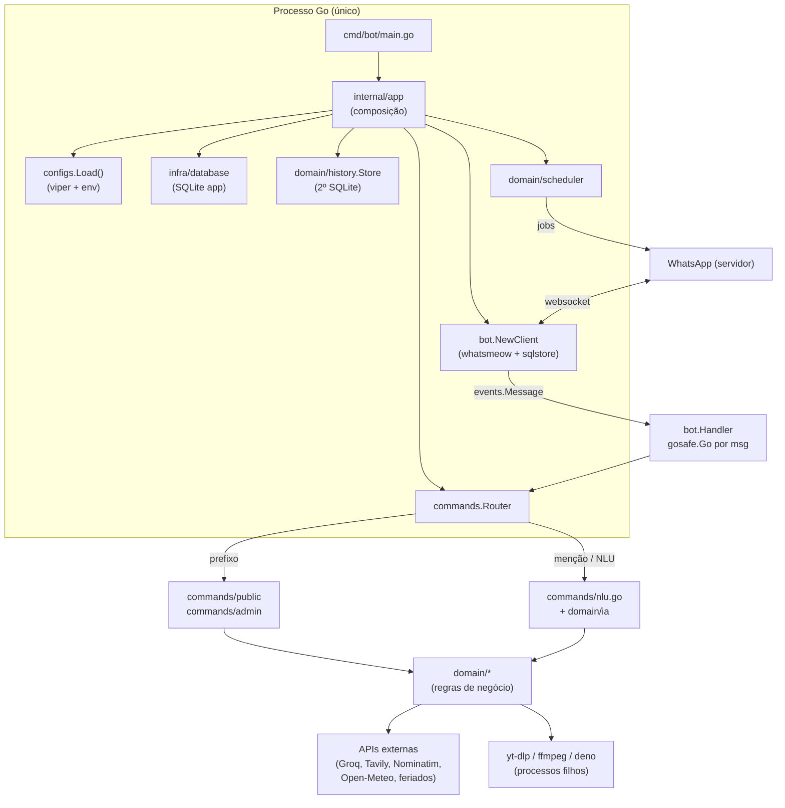

# Shinobu-Whatsapp — Arquitetura Atual

> Snapshot do estado do repositório em **2026-11-10** (commit `0a60afa` / release `v2.23.2`).
> Documento descritivo: descreve o que **é**, não o que deveria ser. As propostas
> estão em `TARGET_ARCHITECTURE.md` e `IMPLEMENTATION_PLAN.md`.

---

## 1. Visão geral

Monólito Go de processo único que atende comandos de WhatsApp via `whatsmeow`,
com SQLite para sessão do WhatsApp e histórico, e integrações com APIs
externas (Groq, Tavily, Nominatim, Open-Meteo, AwesomeAPI, feriados), além de
download de música via `yt-dlp` como processo filho.

- **Entry points**: `cmd/bot` (o bot) e `cmd/shinobu` (CLI de build/release).
- **Runtime**: 1 processo Go + processos filhos efêmeros (yt-dlp, ffmpeg, deno).
- **Hospedagem**: SquareCloud, plano hobby (`ram: 512`), linguagem `go`.

---

## 2. Estrutura de pacotes

| Pacote | Responsabilidade | Acoplamento |
|---|---|---|
| `cmd/bot` | Entry point; chama `app.Run()` e `log.Fatal` | — |
| `cmd/shinobu` | CLI de terminal (build/test/release); delega ao Makefile | shell |
| `internal/app` | **Composição**: config, logger, DB, stores, client, router, comandos, scheduler | alto (importa quase tudo) |
| `internal/bot` | Cliente whatsmeow (ciclo de vida, QR, eventos) | whatsmeow |
| `internal/commands` | Router, middlewares, rate limit, NLU, album | whatsmeow + history + ia + ignore |
| `internal/commands/public` | Handlers de comando público (24) | whatsmeow + domain |
| `internal/commands/admin` | Handlers admin/owner (19) | whatsmeow + domain |
| `internal/domain/*` | Regras de negócio por subsistema | 8 arquivos importam whatsmeow |
| `internal/integration/whatsapp` | Helpers de envio (text, image, audio, sticker, video, JID) | whatsmeow |
| `internal/integration/media` | Download de mídia do WhatsApp | whatsmeow |
| `internal/infra/*` | config, database, ffmpeg, gosafe, logger, phone, store, uptime, version | baixo |

**Total**: 32 pacotes, ~13.4k linhas de Go (sem testes), 66 arquivos importando
`go.mau.fi/whatsmeow`.

### Maiores arquivos (sem testes)

| Arquivo | Linhas | Observação |
|---|---|---|
| `internal/domain/weather/weather.go` | 460 | API + normalização + janela de previsão |
| `internal/commands/router.go` | 418 | pipeline completo de mensagem |
| `internal/domain/history/message_history.go` | 367 | queries + summaries + facts |
| `internal/domain/weather/card.go` | 356 | render PNG do card de clima |
| `internal/domain/music/ytdlp_exec.go` | 305 | execução do yt-dlp + classificação de erro |
| `internal/commands/public/agenda.go` | 251 | CRUD de lembretes |
| `internal/commands/album.go` | 243 | buffer de álbuns |

---

## 3. Ciclo de vida

### 3.1 Inicialização (`internal/app/app.go:Run`)

Ordem exata:

1. `uptime.Start()` — cronômetro de uptime do processo.
2. `checkDeps()` — **fail-fast**: exige `./bin/ffmpeg`, `./bin/webpmux`,
   `./bin/deno`, `./bin/yt-dlp` (`app.go:196`).
3. `configs.Load()` — viper + YAML + env; **não retorna erro**.
4. `buildLogger(cfg)` — zap em `NewDevelopmentConfig` (formato console), nível
   vindo de `log.level` (default `debug`).
5. `connectDatabase()` — `database/sql` com `modernc.org/sqlite`,
   `SetMaxOpenConns(1)`, DSN `file:storage/storage.db?_pragma=foreign_keys(1)`.
6. `history.NewStore("storage/message_history.db")` — **segundo banco**,
   aberto por `sql.Open("sqlite", path)` sem pragmas.
7. `store.StartCleanup(ctx, 24h)`.
8. `mikael.NewStore(store, store.DB(), …)`.
9. `bot.NewClient(ctx, db, …)` — `sqlstore.NewWithDB(db, "sqlite3", …)` +
   `container.Upgrade(ctx)` + `GetFirstDevice(ctx)`.
10. `client.Connect(ctx)` — QR se não há device.
11. Stores de ignore/sticker (in-memory).
12. `buildRouter()` + middlewares (`IgnoreSelf`, `IgnoreOldMessages`,
    `CommandNotFound`, `PrivateCommands`).
13. `r.SetAIConfig(&ia.Config{... HTTPClient: &http.Client{Timeout: 30s}})`.
14. Registro de comandos (`app_commands.go` 24 públicos, `app_commands_admin.go` 19 admin),
    aliases (`app_aliases.go`).
15. Restauração de jobs dinâmicos do JSON (`storage/dynamic_jobs.json`).
16. Jobs fixos: `birthday.NewBirthdayJob` + `weekday.NewFromConfig` (config YAML).
17. `sched.Start(ctx)`.
18. `bot.NewHandler` + `client.RegisterHandlers`.
19. `client.Listen()` — bloqueia até SIGINT/SIGTERM e chama `Disconnect()`.

### 3.2 Encerramento

- Sinal tratado em `internal/bot/client.go:Listen` (`SIGINT`/`SIGTERM`) →
  `WAClient.Disconnect()` → `app.Run` retorna → `defer db.Close()` e
  `defer store.Close()` executam.
- **Não há cancelamento de contexto**: `ctx := context.Background()` em
  `app.go:52` — scheduler, cleanup e hooks nunca são cancelados.
- `Scheduler.Stop()` existe (`scheduler.go:88`) mas **nunca é chamado**.
- `syscall.Exec` no comando admin `reiniciar` (`admin/restart.go:36`) troca o
  processo sem fechar o DB (sem checkpoint do WAL).

---

## 4. Configuração

`internal/infra/configs/config.go` — viper + YAML `config.yaml` + env.

| Origem | Chaves |
|---|---|
| YAML `config.yaml` | `bot`, `database`, `log`, `usersJID`, `apiUrls`, `scheduledJobs`, `music`, `mikael` |
| Env (BindEnv) | `COMMAND_PREFIX`, `ENVIRONMENT`, `LOG_LEVEL`, `DB_DSN`, `OWNER_JID`, `MUSIC_*`, `YTDLP_PATH`, `FFMPEG_PATH`, `DENO_PATH`, `GROQ_URL`, `GROQ_API_KEY`, `TAVILY_API_KEY`, `FERIADOS_API_KEY`, `OWNER_NUMBER` |
| Defaults viper | `music.*` (localEnabled, tmpDir, cacheDir, maxFileMB=25, maxDownloads=1, timeoutSec=240, ytdlpPath, ffmpegPath) |

Particularidades observadas:

- `Groq`, `Tavily`, `Music`, `Owner`, `Feriados` **não têm `mapstructure`** no
  `Config` — são preenchidos depois com `viper.GetString("apicalls.*")`
  (`config.go:140-163`). Consequência: **esses valores só existem via env var**;
  não são configuráveis por YAML, apesar de `config.example.yaml` sugerir o
  contrário.
- `viper.AutomaticEnv()` com `SetEnvPrefix("")` não tem efeito prático (viper só
  resolve env automático para chaves já existentes na config).
- `Load()` não valida: DSN vazio, owner JID vazio, API key ausente → o bot
  sobe e falha depois, em uso.
- `NormalStickerChance == 0` é sobrescrito para `0.2` (`config.go:135`) —
  impossível desligar stickers aleatórios por config.
- `log.Fatal` da stdlib dentro de `Load()` (`config.go:130`) — sai sem log zap.

---

## 5. Persistência

### 5.1 Dois bancos SQLite

| Banco | Conexão | Conteúdo | PRAGMAs |
|---|---|---|---|
| `storage/storage.db` (22 MB) | `database.Connect()` — `sql.DB` compartilhado com o whatsmeow | tabelas `whatsmeow_*` (device, sessions, identity_keys, lid_map, chat_settings…) | `foreign_keys(1)` no DSN; `SetMaxOpenConns(1)` |
| `storage/message_history.db` (1,1 MB) | `history.NewStore()` → `sql.Open("sqlite", path)` | `messages`, `chat_summaries`, `user_facts`, `user_memory`, `word_counts` | **nenhuma**; sem `busy_timeout`; `MaxOpenConns` default |

- `sqlstore.NewWithDB(db, "sqlite3", …)` (`internal/bot/client.go:33`) usa o
  **mesmo `*sql.DB`** do app → whatsmeow e app disputam **uma única conexão**.
- Migrações: só o `container.Upgrade(ctx)` do whatsmeow. As tabelas do app
  (`messages`, `chat_summaries`…) são criadas por `CREATE TABLE IF NOT EXISTS`
  no próprio `history.NewStore` — **sem versionamento de schema**.
- Dados voláteis (reiniciam vazios): `ignore` (JSON em `assets/info/ignored.json`),
  `sticker` (in-memory), `birthday` (in-memory).

### 5.2 Device WhatsApp

`storage.db` contém 1 device (`whatsmeow_device`) — a sessão é o ativo mais
precioso do projeto. Reconstruir o arquivo invalida a sessão (regra 14 do
briefing).

---

## 6. WhatsApp / whatsmeow

- Versão: `go.mau.fi/whatsmeow v0.0.0-20260713112832-d8960d9575d2`.
- Criação: `whatsmeow.NewClient(deviceStore, waLogger)`; logger próprio em
  `internal/infra/logger` (adapter zap → `waLog.Logger`).
- Eventos: **apenas `*events.Message`** são tratados
  (`internal/bot/handler.go:50`); cada mensagem vira uma goroutine via
  `gosafe.Go` (`handler.go:54`).
- Não há handler para `Disconnected`, `LoggedOut`, `StreamReplaced`,
  `ConnectFailure`, `TemporaryBan`; `EnableAutoReconnect` não é habilitado.
- Fluxo de uma mensagem (`commands/router.go:HandleMessage`):
  filtro de broadcast/status → filtro de ignorar → hooks (mikael) → rate limit
  (10/min por sender) → prefixo `!` → comando; senão → NLU (só se
  `nlpGroupTrigger` ou menção).
- Handlers rodam com `ctx` de 180 s (`handlerTimeoutCommand`), criado a partir
  de `context.Background()` (não cancelável no shutdown).

Detalhe da biblioteca (verificado no fonte do whatsmeow):
`dispatchEvent` chama os handlers **de forma síncrona** (`client.go:923-937`);
para mensagens, a chamada parte de `message.go:839` no loop de leitura do
websocket. Como o `EventHandler` do projeto despacha para uma goroutine, o
read loop **não** fica bloqueado por comandos lentos — mas o número de
goroutines é ilimitado.

---

## 7. Integrações externas

| Integração | Onde | Timeout | Observação |
|---|---|---|---|
| Groq (IA) | `domain/ia/groq.go` | client HTTP 30 s (`app.go:88`) | retry com backoff p/ 429 (2 tentativas) |
| Tavily | `domain/ia/tavily.go` | mesmo client | `Country: brazil`, score ≥ 0.3 |
| Nominatim | `domain/geocoding/geocode.go` | — | User-Agent obrigatório |
| Open-Meteo (geo/clima) | `domain/geocoding`, `domain/weather` | — | janela 16 dias |
| AwesomeAPI (cotações) | `domain/cotacao` | — | |
| Feriados | `domain/feriado` | — | exige `FERIADOS_API_KEY` |
| yt-dlp/ffmpeg/deno | `domain/music/ytdlp_exec.go` | `music.timeoutSec=240` | `exec.CommandContext`, sem shell; semáforo `MaxDownloads=1`; erros categorizados (`ErrCategory`) |
| noteapi (notebook) | `domain/noteapi` + `commands/admin/note.go` | — | **fallback legado** do `!play` + 6 comandos admin |

---

## 8. Concorrência e recursos

- `gosafe.Go(logger, fn)`: goroutine com `recover` — sem `WaitGroup`, sem
  cancelamento, sem limite de concorrência (`internal/infra/gosafe/gosafe.go`).
- Scheduler: ticker de 15 s, jobs executados **na goroutine do ticker**
  (`scheduler.go:checkAndRun`), com `context.Background()` e timeout de 5 min;
  o mutex é liberado durante a execução do job.
- Rate limit: 10 mensagens/min por sender, mapa em memória com cleanup
  periódico.
- Album: buffer de 10 s, limite de 30 itens.

### Consumo real medido (SquareCloud, 24 h, 286 amostras de 5 min)

| Métrica | min | mediana | máx |
|---|---|---|---|
| RAM | 2 MB | 18 MB | **66 MB** (13% do limite de 512 MB) |
| CPU | 0,0% | 0,0% | **0,6%** |

O gargalo **não é RAM/CPU** — é **disco** (binários `bin/` = 216 MB: deno 96 MB,
ffmpeg 80 MB, yt-dlp 41 MB) e a **sessão única do WhatsApp** (um device = uma
conexão).

---

## 9. Testes e qualidade

| Pacote | Cobertura |
|---|---|
| `domain/history` | 57,2% |
| `domain/music` | 33,8% |
| `internal/commands` | 29,2% |
| `domain/scheduler` | 26,6% |
| `domain/geocoding` | 17,6% |
| `commands/public` | 11,1% |
| `domain/ia` | 5,1% |
| `domain/weather` | 3,2% |
| `app`, `bot`, `commands/admin`, `configs`, `database`, `media`, `whatsapp` | **0%** |

`go vet ./...` limpo. `go test ./...` verde (7 pacotes com testes).
Testes de integração de API real existem mas são build-tagged (`integration`).

---

## 10. Superfície de comandos

43 comandos registrados: `agenda, aniversário, cafe, chatinfo, clima, contagem,
cotacao, dio, efeito, fato, feriado, fig, filme, groupjid, ignorar, jobs,
limpar_cache, mambo, manutencao, memoria, menu, mikael, note, noticia, piada,
ping, play, rawevent, rawmsg, receita, reiniciar_api, reiniciar_note,
reiniciar_tunel, resetar_wifi, restart, shinobu, shutdown, stats, sticker,
testjob, traduz, unsticker, whois`.

Metadados (`CommandMeta`) alimentam a geração automática do menu
(`commands/public/menu.go`).

---

## 11. Build e deploy

- `make build` → binário estático `Shinobu` (~25 MB, `CGO_ENABLED=0`,
  `-trimpath -ldflags "-s -w"`, versão cravada em `internal/infra/version`).
- `make release` → testes → build → commit (**inclui o binário no git**) →
  tag semver → push.
- O plano da SquareCloud não compila em container: o binário é versionado e a
  plataforma executa o arquivo.
- `scripts/setup.sh` baixa `yt-dlp`, `deno`, `ffmpeg` (estático) e `webpmux`
  (~216 MB) — fora do git (`.gitignore` ignora `bin/`).
