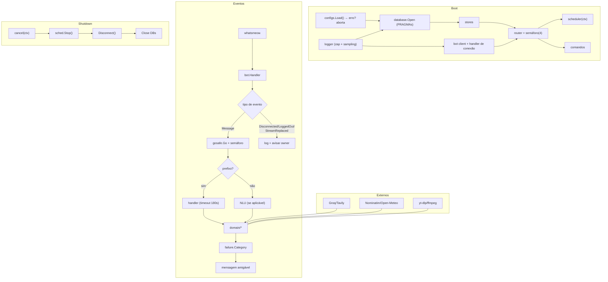

# Shinobu-Whatsapp — Arquitetura de Destino

> Proposta derivada da auditoria (`ARCHITECTURE_AUDIT.md`).
> Princípio: **manter o que já funciona**, fechar lacunas com o menor número de
> mudanças, e não introduzir camadas, frameworks ou infraestrutura.

---

## 1. Decisão estrutural: monolólito modular (mantido)

**Validação:** o monólito modular **é** a arquitetura correta aqui — e é o que já
existe.

| Alternativa | Veredito | Motivo |
|---|---|---|
| Monólito modular (atual) | ✅ mantido | 1 processo, 1 sessão WhatsApp, 43 comandos; 32 pacotes já separam domínio / integrações / infra; RAM real de 66 MB de 512 MB |
| Monólito "gordura" (pacotes planos) | ❌ | Perde a separação domínio/infra que já existe e que dá suporte aos testes de domínio |
| Microserviços / filas / Redis | ❌ | Não há necessidade concreta: o gargalo é disco e a sessão única, não throughput |
| Camada de abstração sobre o whatsmeow | ❌ | Reimplementaria o que a biblioteca já resolve (spec §5: "não duplique responsabilidades do whatsmeow") |

**O que muda:** não é a estrutura de pastas — é o **ciclo de vida**, a
**fonte única de configuração**, o **trato de erros** e o **limite de
concorrência**. Tudo dentro dos pacotes existentes.

---

## 2. Organização de responsabilidades (proposta)

```
cmd/bot/            entry point: sinal → app.Run → saída
cmd/shinobu/        CLI de release (delega ao Makefile)      [mantido]

internal/app/       composição: config → logger → db → stores → client → router → scheduler
                    + shutdown ordenado (defer chain)          [ajustado]

internal/bot/       ciclo de vida do whatsmeow + eventos de CONEXÃO (novo)  [ajustado]

internal/commands/  roteamento, middlewares, limite de concorrência, NLU
                    (assinatura crua do whatsmeow mantida)     [ajustado]

internal/commands/public|admin/   interação com o usuário (sem regra de negócio)

internal/domain/*   regras de negócio por subsistema (sem HTTP direto quando
                    não for a integração que lhe cabe)

internal/integration/whatsapp/   camada de ENVIO (texto, mídia, JID)  [mantida]
internal/integration/media/       download de mídia                   [mantida]

internal/infra/database/          abertura de SQLite + política de PRAGMA  [ajustado]
internal/infra/configs/           Load() com erro + validação          [ajustado]
internal/infra/gosafe/            goroutine com recover (+ grupo)      [ajustado]
internal/infra/logger/            zap + adapters do whatsmeow          [mantido]

internal/domain/failure/   taxonomia de falha por categoria → mensagem  [novo, pequeno]
```

**Sobre `internal/domain/failure`:** não é um framework de erros. É a
**generalização de um padrão que já existe e já funciona** no
`domain/music` (`ErrCategory` + `CategoryText`, `ytdlp_exec.go:34-70`), que
hoje só a música usa..weather, geocoding, feriado e cotação passam a classificar
a falha do mesmo jeito, e o router transforma a categoria em mensagem
amigável.

---

## 3. Fluxo de dependências (proibido por construção)

```
commands/public  ──► domain/<regra>          (nunca o contrário)
commands/public  ──► integration/whatsapp     (envio)
domain/<regra>   ──► integration/<api>        (HTTP/binário)
domain/<regra>   ──► infra/database           (SQL, via store do domínio)
app              ──► todos (só compõe)
```

- `domain/*` **não** importa `commands` (hoje já é verdade).
- `domain/*` importam `whatsmeow` em 8 arquivos — **decisão consciente de não
  mudar** (tipos do cliente são ergonomia; abstraí-los seria reimplementar a
  biblioteca). Onde a dependência atrapalha o teste, extrai-se **o suficiente**
  (ex.: `failure`), não tudo.

```mermaid
flowchart TB
  subgraph boot["Inicialização (internal/app)"]
    cfg["configs.Load() → (*Config, error)\nvalidação falhar = aborta"]
    log["buildLogger"]
    db["database.Open()\nPRAGMA foreign_keys/busy_timeout\nMaxOpenConns(1)"]
    stores["stores (history, ignore, sticker)"]
    wa["bot.NewClient + RegisterHandlers\n(conexão: Disconnected/LoggedOut/\nStreamReplaced/ConnectFailure)"]
    r["buildRouter\n+ limite de concorrência"]
    sched["scheduler (ctx cancelável)"]
    cmds["registro de comandos"]
  end

  cfg --> db --> stores --> r
  cfg --> wa --> r
  r --> sched
  r --> cmds
  log --> db
  log --> wa
  log --> r
  log --> sched

  subgraph run["Execução"]
    ev["whatsmeow event loop"] -->|"msg"| g["router (semáforo de handlers)"]
    g -->|"prefixo"| h["handler"]
    g -->|"menção/NLU"| nlu["nlu"]
    h --> dom["domain/*"]
    nlu --> dom
    dom --> fail["domain/failure\ncategoria → mensagem"]
    dom --> api["APIs / binários"]
  end

  subgraph stop["Encerramento (defer chain)"]
    s1["cancel() contexto raiz"] --> s2["scheduler.Stop()"] --> s3["client.Disconnect()"] --> s4["db.Close()"]
  end
```



---

## 4. Inicialização e encerramento

### 4.1 Inicialização (mudanças em `internal/app/app.go`)

1. `configs.Load()` passa a devolver `(*Config, error)`; falha → aborta com
   mensagem clara (**C-02**).
2. `checkDeps()` passa a ser condicional ao modo de música (**I-10**).
3. `ctx, cancel := context.WithCancel(context.Background())` no topo;
   `defer cancel()` (**R-01**).
4. Um único ponto de abertura de SQLite (`database.Open`) com a política de
   PRAGMA, usado pelo `storage.db` **e** pelo `message_history.db` (**P-01**).

### 4.2 Encerramento (novo, explícito)

```go
func Run() error {
    ctx, cancel := context.WithCancel(context.Background())
    defer cancel()                     // 1. cancela o contexto raiz
    ...
    defer sched.Stop()                 // 2. para o scheduler
    defer client.Disconnect()          // 3. fecha a sessão WhatsApp
    defer store.Close()                // 4. fecha os bancos
    defer db.Close()
    return client.Listen(ctx)          // bloqueia até SIGINT/SIGTERM
}
```

`bot.Listen` passa a receber o `ctx` e a parar por `ctx.Done()` **ou** sinal
(hoje só sinal, `bot/client.go:99-110`).

### 4.3 O que **não** muda

- A ordem de inicialização atual é previsível e testada — não se mexe.
- `cmd/bot/main.go` continua com `log.Fatal` no bootstrap (é o lugar certo).

---

## 5. Estratégia de integração com o whatsmeow

**Mantido:** cliente `*whatsmeow.Client` real nos handlers; `sqlstore` com o
`*sql.DB` do app; helpers em `internal/integration/whatsapp`; QR no terminal.

**Novo (única mudança relevante):** handler de **eventos de conexão**, no mesmo
`bot.Handler` que já existe (`internal/bot/handler.go`):

| Evento | Ação |
|---|---|
| `events.Connected` | log `Info` + (opcional) avisar o owner que voltou |
| `events.Disconnected` | log `Warn` com o motivo + contador de quedas |
| `events.LoggedOut` | log `Error` **crítico** + avisar o owner (sessão invalidada → precisa parear de novo) |
| `events.StreamReplaced` | log `Error` + avisar o owner (outro device conectou) |
| `events.ConnectFailure` | log `Warn`/`Error` com o motivo |
| `events.TemporaryBan` | log `Error` + avisar o owner |

E `client.EnableAutoReconnect = true` (**W-02**) — a biblioteca já implementa o
reconexão (`keepalive.go:44-53`).

**Limite de concorrência (W-03):** semáforo no router (N = 4 por padrão),
aplicado **antes** de despachar o handler. Excedente → mensagem curta ao
usuário ("estou ocupada, tente em instantes") em vez de acumular goroutines.
O `music` mantém seu próprio semáforo (1 download) — são controles
complementares (um limita handlers, o outro limita downloads).

### 5.1 Identidade do owner (I-01, I-02, I-03) — prioridade máxima

Hoje existem **três** comparações de identidade e **duas** configurações:

| Onde | Compara | Formato |
|---|---|---|
| `commands/middleware.go:66` | `Sender.ToNonAD().String() == owner` | JID completo (`…@lid`) |
| `domain/sticker/handler.go:26`, `domain/birthday/handler.go:204` | `NormalizeNumber(Sender.User) == NormalizeNumber(owner)` | só dígitos |
| `commands/public/shinobu.go:46` | `Sender.User == cfg.Owner.Number` | string crua |

**Alvo:** uma função, um lugar:

```go
// internal/commands/identity.go (novo, ~40 linhas)
// IsOwner responde "este remetente é o dono?".
// Aceita número normalizado OU JID (lid/s.whatsapp.net) — os dois formatos
// são aceitos porque o endereçamento da conta pode mudar.
func IsOwner(sender types.JID, owner config.OwnerIdentity) bool
```

- `config.OwnerIdentity` substitui `UsersJID.Owner` + `Owner.Number` por
  **uma** estrutura com os dois campos (`number` e `jid`) — **compatibilidade
  preservada**: as env vars atuais (`OWNER_JID`, `OWNER_NUMBER`) continuam
  valendo.
- `SetBotJID` passa a ser chamado no boot com o ID do próprio device
  (`client.WAClient.Store.ID.ToNonAD().String()`), resolvendo I-02.
- A lista de ignorados passa a ser consultada com **número e JID**
  normalizados, resolvendo I-03.

**Não** é uma "camada de identidade": é uma função com 4 call sites.

### 5.2 Limite de tamanho de resposta (U-08)

`whatsapp.SendText` passa a truncar em ~3500 caracteres (o WhatsApp rejeita
acima de ~4096) e acrescentar "… (continua)". Com isso, `!agenda lista`,
`!memoria` e `!menu` deixam de poder falhar por tamanho.

### 5.3 Erro de "não é este comando" (A-08)

`ErrNotACommand` passa a ser tratado **também** no caminho com prefixo: o
router responde "não entendi essa moeda, tenta assim: `!cotacao`" em vez de
silenciar. O sentinel já existe (`commands/types.go:13`) — falta tratá-lo no
segundo call site.

**Não** se cria `interface{ SendText(...) }` genérica para o WhatsApp: o
`internal/integration/whatsapp` já é a fronteira de envio; a assinatura crua
nos handlers é idiomática e economiza uma camada (**O-02**).

---

## 6. Estratégia para integrações externas

Regras que valem para todas (e que já são parcialmente verdadeiras):

1. **Um `http.Client` por integração, criado na composição e injetado** — nunca
   por chamada (**I-05**). Timeouts: 8–10 s para geocoding/clima/cotação/
   feriado, 30 s para IA, 90 s para o túnel legado.
2. **Todo request com `context`** — hoje já é 100% (`http.NewRequestWithContext`).
3. **Corpo de resposta limitado** (`io.LimitReader`) em toda leitura de body
   externo (**I-04**).
4. **Falha classificada** com taxonomia compartilhada (`domain/failure`),
  军的convertida em mensagem amigável no ponto de uso.
5. **Cache em memória com TTL** para dados que mudam pouco (**I-03**):
   - geocoding: 10 min (por query normalizada)
   - clima: 10 min (por cidade+data)
   - cotação: 30 min
   - feriado: 6 h (por ano)
   Implementação: um `cache` genérico pequeno em `internal/infra/cache`
   (map + TTL, sem dependência) — não um framework.
6. **Retry só onde compensa**: resposta principal do Groq (idempotente no
   efeito). Classificador/resumo/fatos: 1 tentativa (**I-01**).
7. **Nenhum segredo em log** — já é o caso; a chave vai só no header.

---

## 7. Persistência

- **Um ponto de abertura** (`internal/infra/database.Open(path)`) com:
  `PRAGMA foreign_keys(1)`, `PRAGMA busy_timeout(5000)`, `SetMaxOpenConns(1)`,
  `SetMaxIdleConns(1)` — aplicado ao `storage.db` e ao `message_history.db`
  (**P-01**, **P-03**).
- **Dois arquivos, por decisão**: `storage.db` = sessão do WhatsApp (ativo
  crítico, backup próprio); `message_history.db` = dados do app. Registrado na
  documentação para quem newcomer (**P-02**).
- **Schema**: segue sem versionamento (5 tabelas estáveis) — só muda se mudar
  (**D-01** do débito).
- **Backup**: o `storage.db` é o único insubstituível → política de backup fica
  como tarefa do dono (o app nunca o apaga; `syscall.Exec` mantém o arquivo).

---

## 8. Tratamento de erros e observabilidade

### 8.1 Taxonomia (generalizar o padrão existente, não criar framework)

```go
// internal/domain/failure
type Category int
const (
    Unknown Category = iota
    Unavailable   // serviço externo fora do ar / timeout
    Forbidden     // upstream recusou (403/429/bot protection)
    InvalidInput  // entrada do usuário
    NotFound      // recurso inexistente
    Permanent     // falha que não adianta repetir
)
func (c Category) UserMessage() string   // voz da Shinobu, sem detalhe interno
func Classify(err error) Category        // wraps: erro já classificado mantém-se
```

- `domain/music` migra de `ErrCategory` próprio para `failure.Category`
  (mantendo as 8 categorias específicas como detalhe do log).
- `weather`, `geocoding`, `feriado`, `cotacao`, `noteapi` passam a classificar.
- O **router** traduz: erro não tratado → `failure.Classify(err).UserMessage()`
  → responde ao usuário **e** loga (**O-03**, **U-01**).

### 8.2 Observabilidade

- `zap` com `sampling` em `debug` (volume) — **M-02**.
- `logger.Named("SUBSISTEMA")` já padronizado (`app.go`): manter.
- Erros sempre com `%w` (2 exceções reais corrigidas: `sticker/convert.go:143`).
- **Nada de PII**: remover log de args crus do usuário (**U-05**), truncar por
  runes (**U-06**), não logar corpo bruto de LLM (**U-04**).
- **Identificador de operação**: para `!play` (download longo) já existe
  `ErrCategory`; o suficiente agora é logar `query` + `category` + `duration`
  (o `!play` já loga em `play.go:33`).

---

## 9. Concorrência e controle de recursos

| Recurso | Hoje | Alvo |
|---|---|---|
| Handlers simultâneos | ilimitado | **semáforo de 4** no router |
| Downloads de música | 1 (`MaxDownloads`) | manter 1 (RAM) |
| Goroutines em background | `gosafe.Go` sem wait | `gosafe.Go` + `Group` p/ esperar no shutdown |
| Jobs do scheduler | na goroutine do ticker | em goroutine própria, com `ctx` do scheduler |
| Conexões SQLite | 1 (storage) / default (history) | 1 em ambos |
| HTTP clients | 1 por integração (criado na composição) | idem + reutilização |
| Temporários | nome por PID | `os.CreateTemp` (único) |

Orçamento de RAM validado (medido, 24 h): **66 MB de pico** com limite de 512 MB.
O gargalo real é **disco** (`bin/` = 216 MB) e a **sessão única**.

---

## 10. Experiência do usuário

Objetivo: o usuário sempre sabe o que aconteceu.

| Situação | Hoje | Alvo |
|---|---|---|
| Comando falha (erro não tratado) | silêncio | mensagem por categoria (`failure`) |
| `!play` — YouTube recusa | ✅ já bom (8 categorias) | manter + generalizar |
| `!clima` — API fora | "Não consegui buscar o clima agora" ✅ | manter |
| `!clima` — resposta parcial | **panic silencioso** | fallback textual (A-01/A-02 corrigidos) |
| Comando admin falhando | "✅ API reiniciando" (falso) | mensagem verdadeira (A-03) |
| Comando desconhecido | middleware existe | garantir que a sugestão liste 2–3 comandos parecidos |
| Timeout de 30 s na IA | "Algo deu errado" | timeout maior na menção + "tente de novo" (**U-02**) |

Sem alterar a personalidade: as mensagens continuam no arquivo
`commands/public/messages.go` (41 mensagens já prontas) e o tom da Shinobu
(idiotice carinhosa, "tolo", "mimir patrão") é preservado.

---

## 11. Testabilidade

Alvo: **testar sem WhatsApp, sem API real, sem credenciais**.

| Camada | Estratégia | Exemplo |
|---|---|---|
| `domain/*` | tabela de entradas/saídas + fake de HTTP (`httptest`) | `clipWindow`, `classifyErr`, `parseAgendaTime` |
| `domain/failure` | tabela categoria ↔ mensagem | trivial e importante |
| `commands` | fake de envio + evento sintético | roteamento, rate limit, NLU |
| `infra/configs` | tabela env ↔ YAML com arquivo temporário | precedência e validação |
| `infra/database` | SQLite em `:memory:`/tempdir | PRAGMA e concorrência |
| `app` | composição com dependências fake | ordem de inicialização e shutdown |

**Regra:** fake mínimo, interface só onde o teste precisa. Nada de mock
framework novo (o projeto já usa `stretchr/testify`).

---

## 12. Diagrama da arquitetura proposta



---

## 13. O que será mantido, movido, simplificado, isolado ou removido

| Ação | Item | Justificativa |
|---|---|---|
| **Mantido** | Estrutura de pacotes (`cmd`/`app`/`bot`/`commands`/`domain`/`integration`/`infra`) | já separa responsabilidades; trocar seria churn |
| **Mantido** | Assinatura crua do whatsmeow nos handlers | idiomática; abstração custaria mais do que rende |
| **Mantido** | `internal/integration/whatsapp` como camada de envio | já é a fronteira certa |
| **Mantido** | `domain/music` (execução de processo externo) | exemplar — é o modelo a seguir |
| **Mantido** | `commands/public/messages.go` | base da UX; só vai crescer |
| **Mantido** | `domain/failure` herdado de `music.ErrCategory` | generalizar padrão existente |
| **Simplificado** | `configs.Load()` — uma fonte de verdade, com erro | elimina C-01..C-06 |
| **Simplificado** | Abertura de SQLite — 1 helper, 1 política | elimina P-01/P-03 |
| **Simplificado** | Temporários — `os.CreateTemp` | elimina A-04 |
| **Isolado** | Conexão do WhatsApp: eventos de conexão + auto-reconnect | elimina W-01/W-02 |
| **Isolado** | Identidade do owner: uma função (`IsOwner`) + `SetBotJID` no boot | elimina I-01/I-02/I-03 |
| **Isolado** | Concorrência: semáforo no router | elimina W-03 |
| **Isolado** | Lifecycle: contexto raiz + defer chain | elimina R-01/R-02 |
| **Movido** | Taxonomia de erro: `music` → `domain/failure` | compartilhável sem duplicar |
| **Removido** | `Cache.Hit` (código morto) | I-11 |
| **Removido** | `fmt.Println` de QR/mensagens → zap | consistência (baixo custo) |
| **Decidir com o dono** | `noteapi` + 6 comandos do notebook | O-05 |
| **Decidir com o dono** | binário no git (D-01) | muda o fluxo de release |
